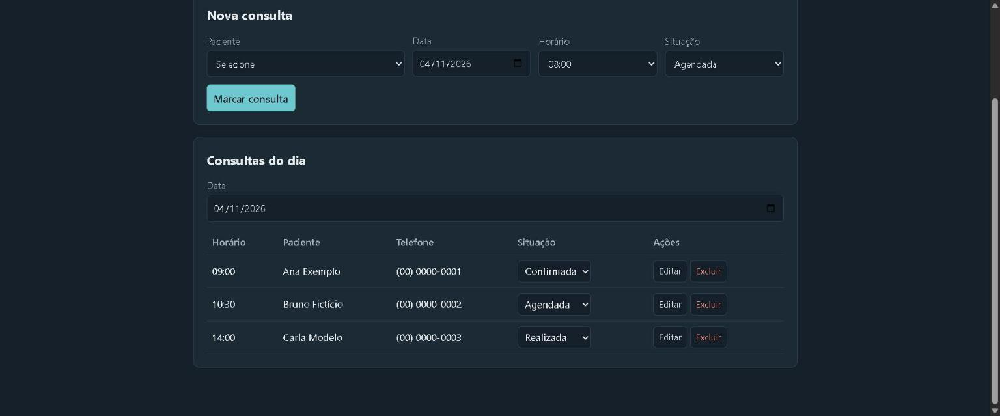
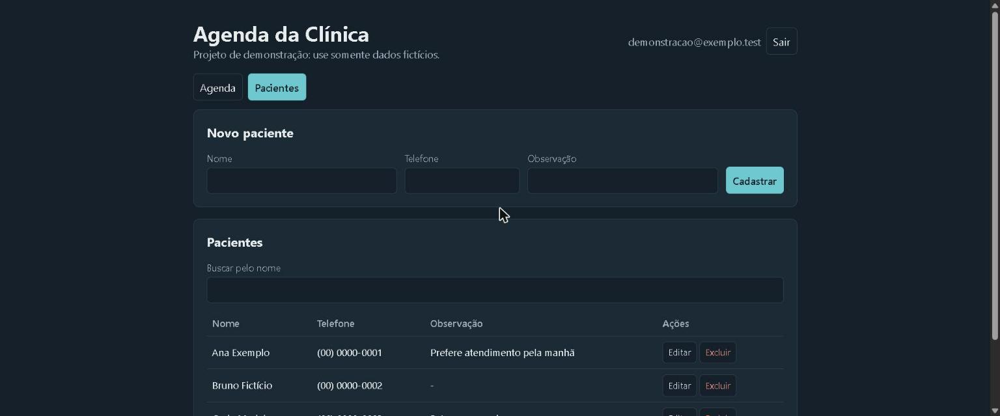

# Agenda da Clínica

Sistema web para organizar pacientes, consultas e confirmação de presença.

**[Abrir o projeto](https://beasil07.github.io/agenda-clinica/)**. Crie uma conta de teste e use somente dados fictícios.



## Problema

Em uma clínica pequena, a agenda precisa mostrar rapidamente quem será atendido, quais horários estão ocupados e quem já confirmou presença. A ideia veio da rotina de uma secretária de clínica.

## Funcionalidades

- Criação de conta, login e logout com e-mail e senha.
- Cadastro, edição, busca e exclusão de pacientes.
- Marcação, edição e exclusão de consultas.
- Bloqueio de duas consultas no mesmo horário.
- Situações: agendada, confirmada, realizada, faltou e cancelada.
- Consultas do dia com filtro por data.
- Bloqueio da exclusão de pacientes com consultas agendadas ou confirmadas.

## Decisões do projeto

- **Dados separados por usuário:** cada conta acessa somente `usuarios/{uid}` no Firestore.
- **Segurança no servidor:** as regras em `firestore.rules` validam o dono e o formato dos dados. A configuração do Firebase no código é pública, por isso a proteção não depende dela.
- **Um documento por horário:** o id da consulta é a data com a hora, e uma transação confere o horário antes de gravar.
- **Regras separadas:** as validações ficam em `regras.js`, o que permite testá-las sem acessar o Firebase.

## Tecnologias

HTML, CSS, JavaScript, Firebase Authentication e Cloud Firestore.

## Como rodar

Sirva a pasta com um servidor local, porque o projeto usa módulos JavaScript:

```bash
python -m http.server 8000
```

Depois, abra `http://localhost:8000`.

## Testes

```bash
npm test
```

## Limitações

Este é um projeto de portfólio e não deve guardar dados reais de pacientes. Para uso real, seriam necessários, entre outros pontos, adequação à LGPD, controle de acesso por perfil, auditoria e recuperação de senha.

## Pacientes


